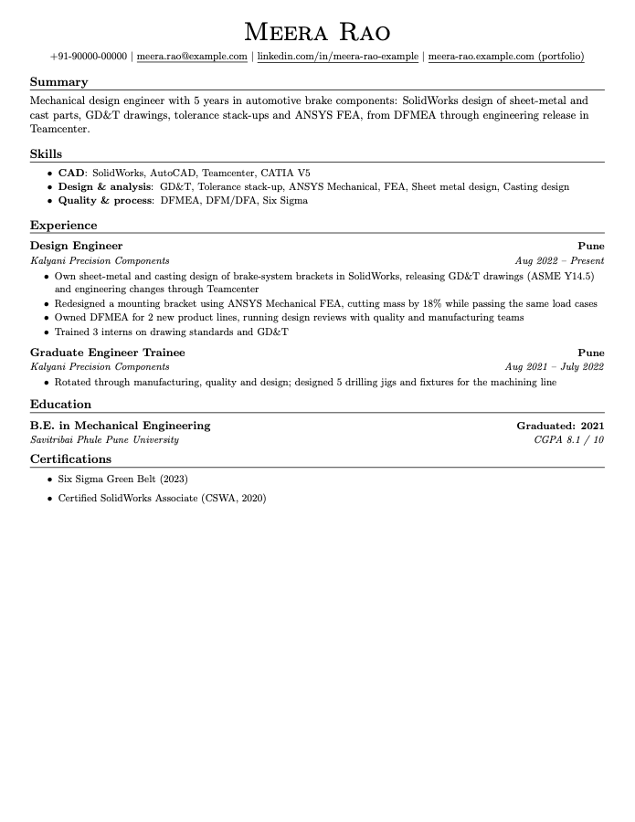
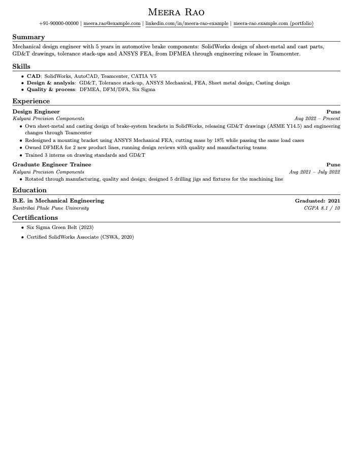
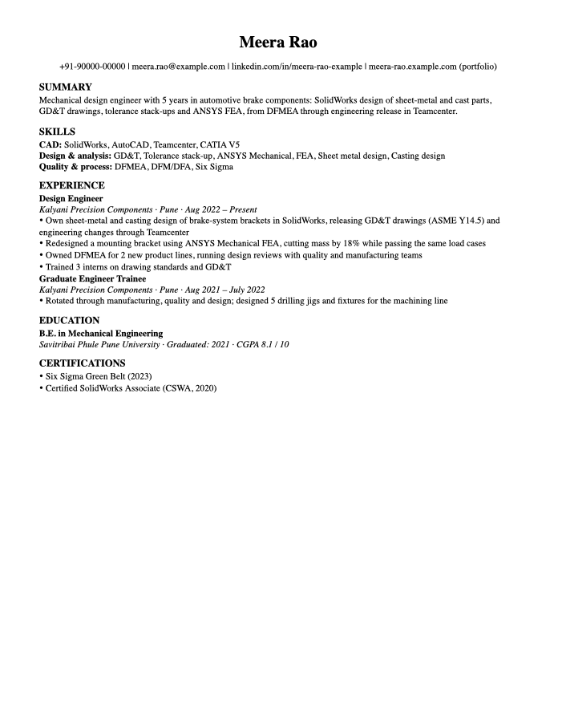

# Resume Generator

Turn rough notes about your career into a verified fact bank, one-page resumes tailored to each
job, a scanned list of matching openings, and an Excel tracker of every application — with any
AI agent doing the writing and you approving every fact.

Works for any profession (software, data, mechanical, civil, design, ...), any AI coding agent
(Claude Code, Codex, Cursor, Gemini CLI, Copilot...), and any number of candidates.

**New here and not technical?** Start with [docs/SETUP.md](docs/SETUP.md): it explains every
install step in plain language. Then tell your agent *"Set me up."*

## How it works

```
notes.txt ─┐                                       ┌─> resumes/<job>/  (PDF or Word, one page)
workrecord ┴─> agent ─> bank.json ── you verify ──┤
                                                    └─> applications.xlsx (tracker + summary)
companies.json ─> scan (feeds) ─┐
sources.json ──> agent browses ─┴─> filter (criteria.json) ─> match (vocab.json) ─> pick ─> tailor ─> apply
```

1. **You write `notes.txt`**: experience, education, achievements, skills, target roles and
   locations, in any form. Optionally list repos/documents in `workrecord.json` as evidence.
2. **Your agent builds `bank.json`**: one verified fact per bullet. Anything it inferred is marked
   unverified until you confirm it. Resumes can only use verified facts, and a script refuses any
   resume that adds a number or skill the bank doesn't contain.
3. **Your agent sets up your field**: job-title filters (`criteria.json`), the words recruiters in
   your field use (`vocab.json`), target employers (`companies.json`), and which sites to search
   (`sources.json`).
4. **Scan → pick → tailor → apply.** The scanner reads company job boards; the agent can also search
   sites like Naukri or LinkedIn in your browser. Jobs are filtered, scored, and the best one per
   company is proposed. The agent tailors a resume for it, checks how it parses for applicant
   tracking systems, fills the form, and stops for you to submit.
5. **The tracker** (`applications.xlsx`) records every job and its status, with a live summary
   (applied, replies, interviews, by company and week).

## Quick start

```sh
git clone <this repo> && cd Resume-Generator
python3 -m venv .venv && .venv/bin/pip install -r requirements.txt     # Windows: .venv\Scripts\pip
cp -r profiles/example profiles/<your-name>                            # then edit notes.txt
```
Then ask your agent to follow `tasks/setup-profile.md` and `tasks/build-bank.md`
(or just say *"set me up"*; agents read [AGENTS.md](AGENTS.md)).

Commands (your agent runs these; Windows uses `.venv\Scripts\python`):
```sh
.venv/bin/python engine/check.py all                       # validate your profile
.venv/bin/python engine/scan.py                            # fetch + filter jobs, update the tracker
.venv/bin/python engine/pick.py                            # what to apply to next
.venv/bin/python engine/tailor.py resumes/<folder>/plan.json   # build a resume
.venv/bin/python engine/ats_check.py resumes/<folder>       # parse + keyword check
.venv/bin/python engine/apply.py <key>                     # open the job, resume path, answer sheet
```
Add `--profile <name>` when more than one profile exists.

## Your profile folder

Copy `profiles/example/` (a fictional mechanical engineer) and replace its contents.

| File | What it holds | Who writes it |
|---|---|---|
| `notes.txt` | Free-form career notes + what you're looking for | You |
| `workrecord.json` | Optional evidence: git repos (+ your author names), documents, links | You |
| `bank.json` | Verified facts: contact, experience, projects, education, certifications, skills | Agent drafts, you verify |
| `profile.json` | Name, field, default resume format | Agent |
| `criteria.json` | Experience range, locations, title words, posting age, one application per company | Agent, you adjust |
| `vocab.json` | Your field's tools/methods/phrases, for matching and ATS checks | Agent |
| `companies.json` | Employers and their job-board ids, work-life-balance/pay ratings | Agent (verifies each feed) |
| `sources.json` | Where to search: company feeds, Naukri, LinkedIn, Indeed, any site — add/remove/disable | You |
| `private/applicant.json` | Standard form answers (notice period, salary, address...) | You |
| `resumes/`, `data/`, `applications.xlsx` | Outputs | Engine |

## Job sources

`sources.json` lists where to look; edit it freely.
- **Feeds** (`type: feeds`): company job boards in `companies.json` read directly — Workday,
  Greenhouse, Lever, Ashby, SmartRecruiters and Amazon. Fast, reliable, no browser needed.
- **Browser sites** (`type: browser`): Naukri, LinkedIn, Indeed, a company's own careers site —
  anything you can open in a browser. Your agent searches them in *your* logged-in browser at a
  human pace (`tasks/browse-search.md`) and drops what it finds into `data/inbox/`; the scanner
  imports those through the same filters. Needs an agent with browser control.
  LinkedIn's terms forbid automated scraping and can restrict accounts, so it ships disabled.

## Resume formats

Formats are templates; content always comes from your bank. Below: the same (fictional) resume
in each built-in format. Click a preview for the full PDF / Word file.

| `classic-latex` (default) | `compact-latex` | `docx-basic` |
|---|---|---|
| [](templates/classic-latex/preview.pdf) | [](templates/compact-latex/preview.pdf) | [](templates/docx-basic/preview.docx) |
| One page, single column, small-caps name, ruled headings. ATS-safe. | Same look, 10pt and tighter margins: fits a longer career on one page. | Plain Word file for portals or companies that ask for .docx. |

Choose per profile (`profile.json` → `default_template`) or per resume (plan → `template`).
To see **your own** resume in every format: `engine/preview_templates.py --mine`
(writes `profiles/<you>/previews/`). To try one without changing anything:
`engine/tailor.py resumes/<folder>/plan.json --template compact-latex --open`.

Want a different look? `tasks/add-template.md` walks you through it without needing LaTeX:
copy a format into `profiles/<you>/templates/`, then change font, size, margins, colours or
bullets with copy-paste recipes. You can also hand your agent any LaTeX design you like
(e.g. from Overleaf) and ask it to adapt it; designs with custom fonts run on XeLaTeX
(`"latex_engine": "xelatex"` in the format's `manifest.json`). After changing a template,
`.venv/bin/python engine/preview_templates.py` regenerates these previews from the example profile.

How rendering works: `tailor.py` checks the plan against your bank and builds a neutral resume
document; `engine/render.py` passes it to the chosen template — LaTeX templates are filled and
compiled to PDF with `pdflatex`, script templates (Word) write the file directly.

## The tracker

`applications.xlsx` has a **Summary** sheet (funnel, per company, per week, applications waiting
over 21 days), the **Applications** sheet (one row per job), and **Applied by Date**.

On Applications, edit only Match, Status, Resume, Applied On, Last Update and Notes; other columns
refresh from the job boards. Status flow: `New → Shortlisted → Tailored → Applied → Responded →
Interview → Offer`, or `Rejected`/`Skipped`. Changing a status stamps Last Update; moving to
Applied stamps Applied On. Jobs whose posting disappears or stops matching your rules are removed
(they return if eligible again); `Skipped` keeps a job from being suggested again. Summary counts
are live formulas — open the file in Excel/Numbers/LibreOffice, not a preview. Close it before a scan.

**One application per company at a time** (`max_active_per_company: 1`), each with a resume
tailored to that job. When a company rejects you, `pick.py` proposes its next-best job.
`companies.json` `resume_policy` records whether a company keeps a resume per application or one
per profile (e.g. Amazon), which matters if you raise that limit.

## Privacy

`profiles/*` is git-ignored except the fictional `profiles/example/`; your data never goes into
this repository. Keep your profile in its own **private** repo if you want history or sync
across machines. Agents follow the rules in [AGENTS.md](AGENTS.md): no invented facts, no typing
passwords, never pressing Submit.

## Limits

- Scanning covers employers with public job-board feeds; others need the browser route.
  Many company portals still need a manual (or agent-assisted) application.
- The LaTeX formats are one-page and single-column by design (best for applicant tracking
  systems); designers will mostly want a portfolio link and a custom template.
- Match scores are keyword-based and meant for sorting; read the description before applying.
